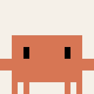
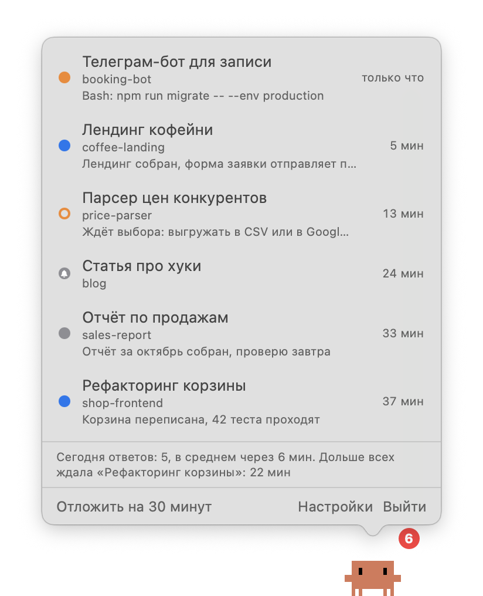
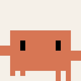
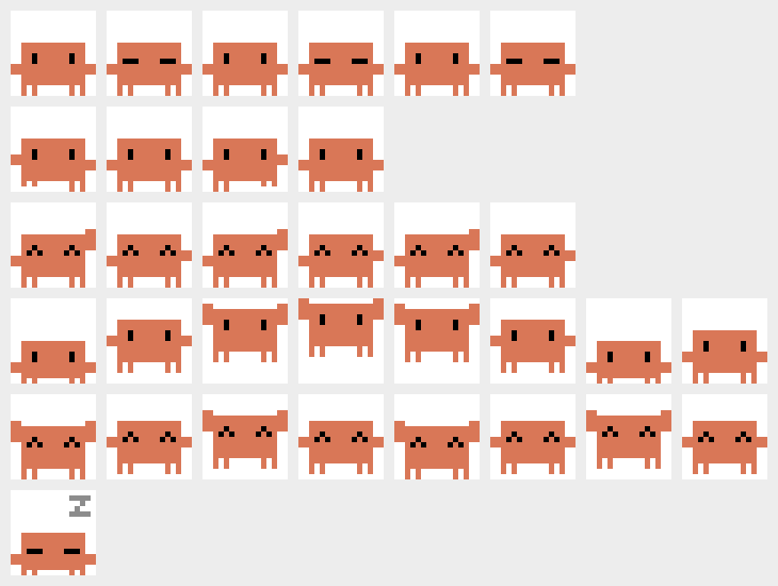
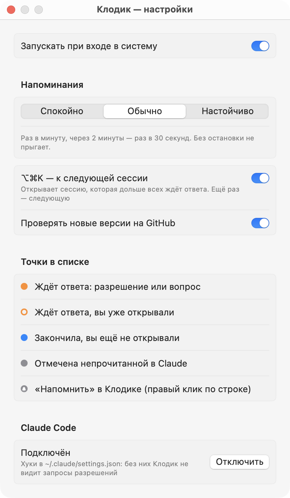
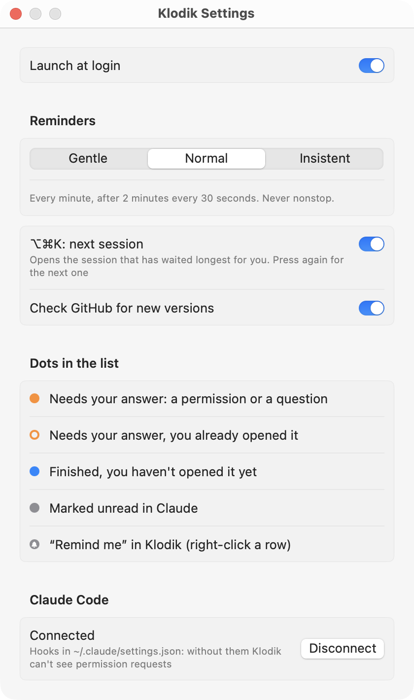

<p align="center">
  
  
  
</p>

<h1 align="center">Клодик</h1>

<p align="center">Пиксельный питомец для Claude Code на macOS. Сидит поверх окон и напоминает о сессиях, которые ждут вас.</p>

> **English:** a tiny pixel pet for the Claude desktop app (Code tab) on macOS. It sits on top of all windows, shows which Claude Code sessions are waiting for your answer or finished unread, and gently nudges you until you deal with them. The UI follows your system language: English or Russian. More in [English](#english) below.

Я веду в приложении Claude по десять сессий параллельно и постоянно пропускал то сессию, которая полчаса назад попросила разрешение, то ту, что давно закончила работу. Поэтому сделал себе Клодика. Он знает обо всех таких сессиях, показывает их число над головой и подпрыгивает, пока я их не разберу. Когда разбирать нечего, он спокойно сидит, а потом засыпает.

## Видео

Показываю, как Клодик работает у меня каждый день, 2 минуты со звуком.

https://github.com/user-attachments/assets/baba8fa6-3eba-478a-84c3-d66fe0d9cad1

## Что он умеет



- **Список по клику.** Клик по Клодику открывает список сессий, которым вы нужны: свежие сверху. Клик по строке открывает именно эту сессию в Claude.
- **Что просит сессия.** Под названием видно, что именно ей нужно: «Bash: npm run migrate», имя файла, текст вопроса или итог хода от Claude. Можно решить, что срочно, не переключаясь.
- **⌥⌘K — к следующей сессии.** Открывает сессию, которая дольше всех ждёт ответа. Нажмите ещё раз — следующую. Очередь можно разобрать, не трогая мышь.
- **Точки как в Claude.**
  - серая — Claude ждёт ответа: просит разрешение или задал вопрос;
  - серая пустая — вы её уже открывали, но не ответили;
  - синяя — закончила работу, вы ещё не смотрели или сами отметили её непрочитанной в Claude;
  - синяя с колокольчиком — ваша метка «Напомнить».
- **Бейдж над головой.** Сколько сессий в списке. Красный, если хоть одна ждёт ответа.
- **Напоминает и успокаивается.** Прыгает из-за свежих сессий, которые ждут ответа. Из-за остальных изредка машет. Пока Claude открыт на переднем плане, молчит.
- **Пузыри.** «Ждёт ответа: …» и «Готово: …», когда сессия только что изменилась.
- **Правый клик по строке.** «Напомнить» — Клодик будет напоминать о сессии, пока вы её не откроете. «Скрыть до следующей активности» — убрать из списка.
- **Сводка за день.** Внизу списка: на сколько запросов вы сегодня ответили, как быстро в среднем и какая сессия ждала дольше всех.
- **Отложить на 30 минут**, если нужно сосредоточиться.

<br clear="right">

## Анимации

Клодик нарисован кодом: каждая поза — сетка 16×16 из символов, без картинок-ресурсов.

| Сидит | Работает | Машет | Прыгает | Радуется | Спит |
|:---:|:---:|:---:|:---:|:---:|:---:|
|  |  |  |  |  |  |
| моргает | Claude работает | есть непрочитанное | ждут ответа | сессия закончила | давно ничего не было |

Так выглядел лист всех кадров, по которому я подбирал позы. Например, поднятые руки сначала читались как рожки, пришлось переделать:

<p align="center"></p>

## Установка

Нужны macOS 14 или новее и [приложение Claude](https://claude.ai/download) с вкладкой Code.

1. Скачайте архив `Klodik-….zip` со страницы [Releases](../../releases/latest) и распакуйте.
2. Перенесите `Klodik.app` в «Программы».
3. Первый запуск. Приложение подписано без сертификата разработчика Apple, поэтому macOS его не пустит с первого раза. Откройте его, нажмите «Готово», затем «Системные настройки» → «Конфиденциальность и безопасность» → внизу «Всё равно открыть». Или одной командой в Терминале:

   ```bash
   xattr -dr com.apple.quarantine /Applications/Klodik.app
   ```

4. Клодик появится в правом нижнем углу экрана. Его можно перетащить куда удобно.
5. Кликните по нему и нажмите «Подключить» внизу списка. Без этого Клодик видит сессии, но не узнаёт о запросах разрешений.

## Настройки



- **Запускать при входе в систему.**
- **Напоминания:**
  - «Спокойно» — прыжок раз в 2 минуты, потом раз в минуту;
  - «Обычно» — раз в минуту, потом раз в 30 секунд;
  - «Настойчиво» — раз в 30 секунд, через 2 минуты без остановки.
- **⌥⌘K — к следующей сессии.** Можно выключить, если сочетание нужно другому приложению.
- **Проверять новые версии на GitHub.** Раз в сутки; когда выходит новая версия, в списке появляется кнопка «Скачать».
- **Claude Code.** Подключить или отключить хуки.

Сессии, которые ждут ответа дольше суток, не заставляют Клодика прыгать, только махать раз в 5 минут.

## Как это работает

Клодик не отправляет ваши данные в интернет и ничего не пишет в сессии. Единственный запрос наружу: раз в сутки он спрашивает у GitHub номер последней версии, это выключается в настройках. О сессиях он узнаёт из двух источников:

- **Файлы сессий приложения Claude** в `~/Library/Application Support/Claude/claude-code-sessions`. Клодик только читает их и следит за изменениями через FSEvents, без опроса.
- **Хуки Claude Code.** Кнопка «Подключить» добавляет в `~/.claude/settings.json` HTTP-хуки на `http://127.0.0.1:47821/klodik/event`. Перед первой правкой сохраняется копия `settings.json.klodik-backup`. Ваши собственные хуки не трогаются. Если Клодик не запущен, хук просто не находит адресата, а Claude работает как обычно.

Клодик открывает сессию ссылкой `claude://code/continue?session=…`, как это делает само приложение Claude.

Нагрузка: около 0,2 % процессора и 14 МБ памяти в покое. Написан на Swift, без Electron и без веб-движка.

Свои данные Клодик хранит в `~/Library/Application Support/Klodik/`: в `state.json` положение на экране, метки и настройки, в `waits.json` журнал ожиданий за 30 дней для сводки. Там же можно поменять порт (`port`) и глубину истории в днях (`windowDays`), если очень нужно.

## Удаление

1. В настройках Клодика нажмите «Отключить» в разделе Claude Code. Хуки уберутся из `settings.json`.
2. Выключите «Запускать при входе в систему» и закройте Клодика.
3. Удалите `Klodik.app` и папку `~/Library/Application Support/Klodik`.

## Сборка из исходников

Нужны Xcode или Command Line Tools со Swift 5.10 и новее.

```bash
git clone https://github.com/sergekruf/klodik.git
cd klodik
swift test
bash scripts/build-app.sh --install
```

`--install` кладёт приложение в `~/Applications` и запускает его. `--release` собирает universal-версию для Apple Silicon и Intel и zip-архив для релиза.

Для разработки есть флаги командной строки: `--sessions` печатает, что Клодик видит прямо сейчас, `--sheet лист.png` и `--frames папка` рисуют кадры анимаций. Переменные `KLODIK_SESSIONS_DIR` и `KLODIK_STATE_DIR` позволяют запустить его на демо-данных.

Клодика я сделал вместе с Claude Code. Как он придумывался: [дизайн](docs/design.md) и [план по шагам](docs/plan.md).

## Ограничения

- Только приложение Claude для macOS, вкладка Code. Сессии в терминале и в VS Code Клодик не видит.
- Формат файлов сессий — внутренний, Anthropic его не документирует. После обновления Claude Клодик может перестать их читать. Тогда в списке появится предупреждение, а он продолжит работать по хукам.
- Версия для Intel собрана, но на Intel-маке не проверялась.

## Отказ от ответственности

Это мой неофициальный проект, он не связан с Anthropic. Claude и Claude Code — товарные знаки Anthropic. Клодик — фанатский персонаж по мотивам талисмана Claude Code.

## English

Klodik is my unofficial desktop pet for the Code tab of the Claude app on macOS. I run about ten sessions in parallel and kept missing the one that asked for permission half an hour ago. Klodik knows about every session that needs me and keeps reminding me until I deal with them.

- **Click the pet** to see sessions that wait for you: gray means Claude needs an answer, blue means a finished turn you haven't seen or a session you marked unread in Claude. Click a row to open exactly that session.
- **See what each session asks for**: `Bash: npm run migrate`, a file name, the question text, or Claude's own turn summary.
- **⌥⌘K** opens the session that has waited longest; press again for the next one.
- **Reminders** grow from a jump per minute to one every 30 seconds (Gentle, Normal and Insistent levels). It stays quiet while Claude is in front.
- **Daily summary**: how many requests you answered today, how fast on average, and the longest wait.
- **Update check**: once a day it asks GitHub for the latest version. That's the only network request; you can turn it off.



**Install:** download the zip from [Releases](../../releases/latest), move `Klodik.app` to Applications, and allow it on first launch in System Settings → Privacy & Security → Open Anyway (the app is not notarized), or run `xattr -dr com.apple.quarantine /Applications/Klodik.app`. Then click Klodik and press **Connect** to add Claude Code hooks (a backup of `~/.claude/settings.json` is saved first). Requires macOS 14+.

## Лицензия

[MIT](LICENSE)
